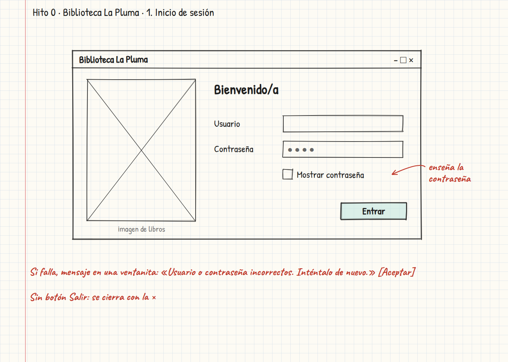
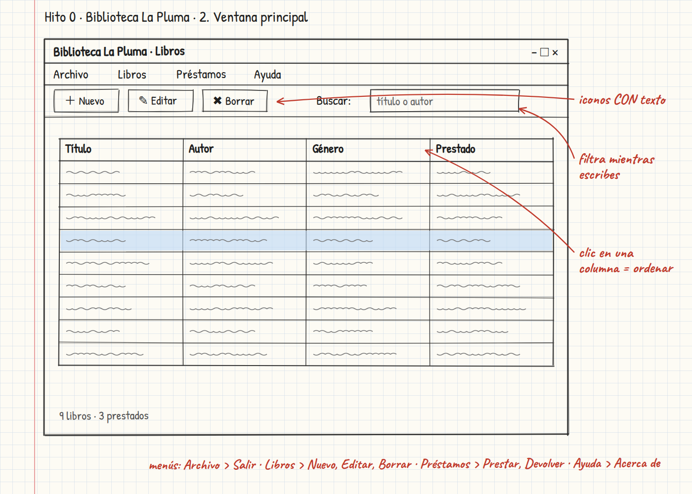
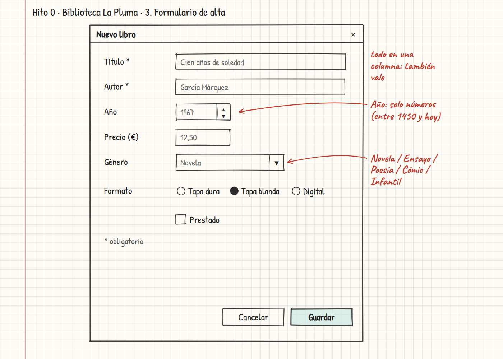

# Ficha de mi aplicación · Hito 0 (EJEMPLO: biblioteca)

- **Alumno/a:** Nombre Apellidos
- **Temática:** biblioteca (Biblioteca La Pluma)
- **Qué gestiona:** libros

## Campos

| # | Campo | Tipo de dato | Componente | Ejemplo de valor / opciones |
|---|-------|--------------|------------|-----------------------------|
| 1 | Título | texto | campo de texto | Cien años de soledad |
| 2 | Autor | texto | campo de texto | Gabriel García Márquez |
| 3 | Año | entero | selector numérico | 1967 |
| 4 | Precio | decimal | campo de texto | 12,50 |
| 5 | Género | lista | lista desplegable | Novela / Ensayo / Poesía / Cómic / Infantil |
| 6 | Formato | opción | botones de opción | Tapa dura / Tapa blanda / Digital |
| 7 | Prestado | sí/no | casilla | no |

## Pantallas

| Pantalla | Foto |
|----------|------|
| Inicio de sesión | `bocetos/1_inicio_sesion.png` |
| Ventana principal | `bocetos/2_ventana_principal.png` |
| Formulario de alta | `bocetos/3_formulario.png` |

### Ventana principal

- **Menús y sus opciones:**
  - Archivo: Salir
  - Libros: Nuevo libro…, Editar, Borrar
  - Préstamos: Prestar, Devolver
  - Ayuda: Acerca de…
- **Columnas de la tabla:** Título, Autor, Género, Prestado
- **Barra de herramientas:** Nuevo, Editar, Borrar (con icono y texto) y un campo para buscar por título o autor.

### Qué hace cada botón

- Inicio de sesión › **Entrar**: comprueba el usuario y la contraseña y abre la ventana principal. La casilla **Mostrar contraseña** enseña lo escrito.
- Ventana principal › **Nuevo**: abre el formulario vacío. **Editar**: abre el formulario con el libro seleccionado. **Borrar**: pide confirmación y borra el libro seleccionado.
- Formulario › **Guardar**: comprueba los campos y guarda. **Cancelar**: cierra sin guardar.

### Mensajes

- Si el usuario o la contraseña están mal: «Usuario o contraseña incorrectos. Inténtalo de nuevo.»
- Si falta un campo obligatorio en el formulario: «Escribe el título del libro para poder guardar.»
- Si el año no es válido: «El año tiene que ser un número entre 1450 y el año actual.»

## Bocetos

