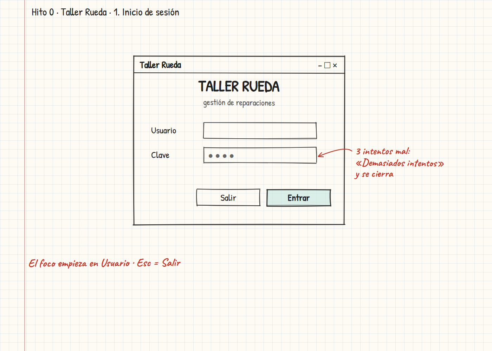
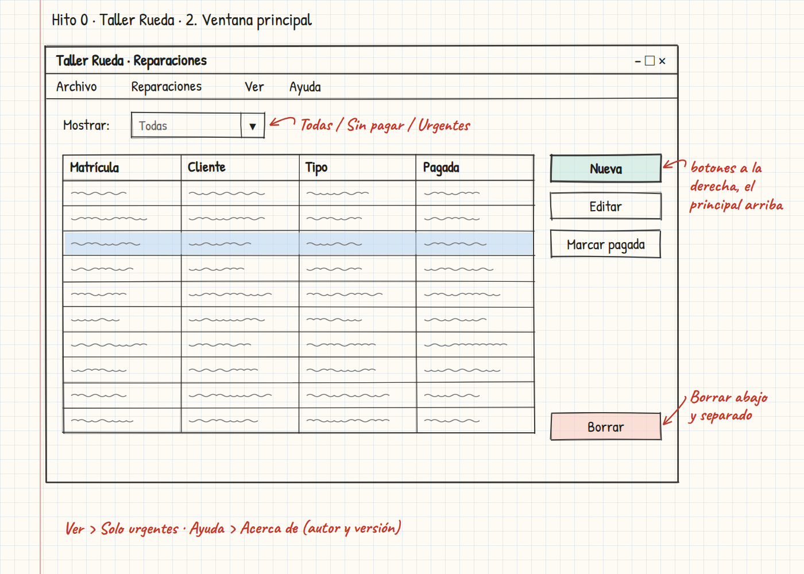
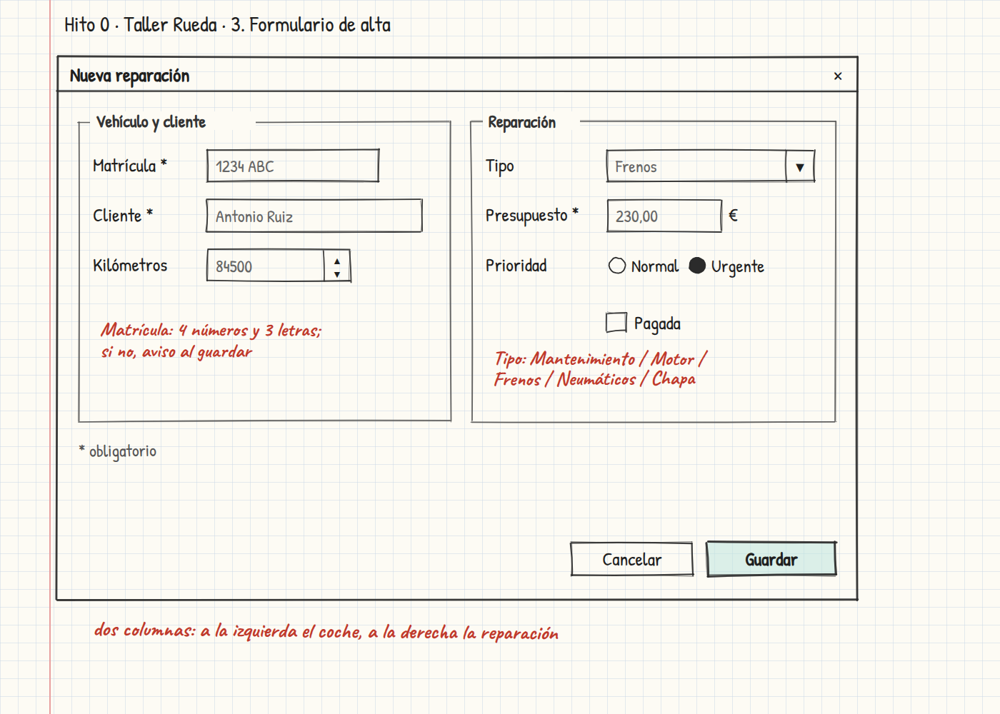

# Ficha de mi aplicación · Hito 0 (EJEMPLO: taller mecánico)

- **Alumno/a:** Nombre Apellidos
- **Temática:** taller mecánico (Taller Rueda)
- **Qué gestiona:** reparaciones

## Campos

| # | Campo | Tipo de dato | Componente | Ejemplo de valor / opciones |
|---|-------|--------------|------------|-----------------------------|
| 1 | Matrícula | texto | campo de texto | 1234 ABC |
| 2 | Cliente | texto | campo de texto | Antonio Ruiz |
| 3 | Kilómetros | entero | selector numérico | 84500 |
| 4 | Presupuesto | decimal | campo de texto | 230,00 |
| 5 | Tipo de reparación | lista | lista desplegable | Mantenimiento / Motor / Frenos / Neumáticos / Chapa |
| 6 | Prioridad | opción | botones de opción | Normal / Urgente |
| 7 | Pagada | sí/no | casilla | no |

## Pantallas

| Pantalla | Foto |
|----------|------|
| Inicio de sesión | `bocetos/1_inicio_sesion.png` |
| Ventana principal | `bocetos/2_ventana_principal.png` |
| Formulario de alta | `bocetos/3_formulario.png` |

### Ventana principal

- **Menús y sus opciones:**
  - Archivo: Salir
  - Reparaciones: Nueva…, Editar, Marcar pagada, Borrar
  - Ver: Solo urgentes
  - Ayuda: Acerca de…
- **Columnas de la tabla:** Matrícula, Cliente, Tipo, Pagada
- **Filtro:** lista «Mostrar» con Todas / Sin pagar / Urgentes.

### Qué hace cada botón

- Inicio de sesión › **Entrar**: comprueba el usuario y la clave y abre la ventana principal. **Salir**: cierra la aplicación.
- Ventana principal › **Nueva**: abre el formulario vacío. **Editar**: abre el formulario con la reparación seleccionada. **Marcar pagada**: marca la seleccionada como pagada. **Borrar**: pide confirmación y la borra.
- Formulario › **Guardar**: comprueba los campos y guarda. **Cancelar**: cierra sin guardar.

### Mensajes

- Si el usuario o la clave están mal: «Usuario o clave incorrectos.» (al tercer intento: «Demasiados intentos» y se cierra).
- Si falta un campo obligatorio: «Escribe la matrícula para poder guardar.»
- Si la matrícula no tiene el formato correcto: «La matrícula tiene que tener 4 números y 3 letras (por ejemplo, 1234 ABC).»

## Bocetos

